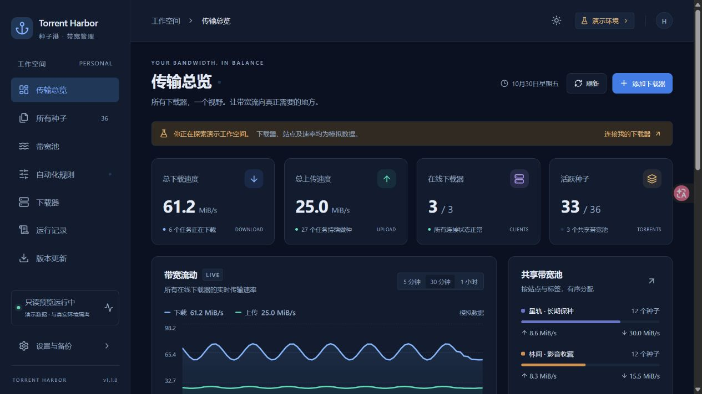

# Torrent Harbor · 种子港

一个本地运行的 Docker 带宽控制台，把多个 qBittorrent 和 Transmission 放到同一页面，按 Tracker、标签和规则管理上传与下载。



上图为独立演示数据。右上角可切换深色与浅色主题。

## 能做什么

- 汇总下载器实时速率、活跃种子、历史速率和连接状态。
- 按全部 Tracker 主机名、原生标签、本地标签、分类、状态与时间匹配规则。
- 同时支持单种上限和分组共享预算；一个池可以覆盖多个 QB/TR 实例。
- 上传、下载分别分配；支持权重、临时调整和需求估计。
- 查看每个种子命中了哪些规则、计划值、原生回读和最近确认写入。
- 写入前保存恢复基线；释放接管时检测外部修改。Transmission 会恢复原始启用状态及记住的数值。
- 深色、浅色主题与移动端布局。
- 从 GitHub Releases 检查更新；可选主机执行器负责安装、备份、健康检查与回退。

## Docker 启动

```sh
git clone https://github.com/misakashiny/torrent-harbor.git
cd torrent-harbor
docker compose up -d --build
```

浏览器打开 `http://你的主机地址:8787`，首次访问设置管理密码。默认进入独立演示环境，在下载器页面保存连接信息后切换真实环境。先预览规则，再开启接管。

下载器与种子港位于不同容器时，下载器地址应使用可达的主机地址或共同 Docker 网络中的服务名。容器内的 `127.0.0.1` 指向该容器自身。也可以按自己的部署方式使用 Linux 主机网络。

`harbor-data` 保存数据库和加密密钥；完整备份必须同时保留二者。配置导出不包含下载器密码。管理密码至少 10 位。反向代理启用 HTTPS 时设置 `COOKIE_SECURE=true`。

## GitHub 更新

普通 Docker 部署可以在页面检查正式 Release。要直接在页面安装更新，需要在 Docker 主机安装 Python 3 与 systemd 执行器：

```sh
sudo python3 tools/install-updater.py --root "$(pwd)" --repository misakashiny/torrent-harbor
```

执行器固定信任指定仓库，只处理种子港容器。网页容器以普通用户运行，不挂载 Docker socket。安装包使用 GitHub Release 中当前架构的 Docker 镜像归档和 SHA-256 校验文件。

在“版本更新”点击检查，释放限速接管后预览并确认安装。执行器先下载校验，再停应用备份数据、切换镜像和检查健康状态。安装失败会尝试恢复；服务中断后也会从事务记录恢复。回退会恢复上一个版本及其当时的数据快照，因此更新后的配置改动也会回退。重启应用后需要重新登录。

支持 Linux amd64、arm64；具体版本是否可安装以 Release 中相应架构的附件为准。自动检查默认关闭；开启后每 6 小时检查一次，安装始终需要确认。未安装执行器时也可以下载 Release 镜像归档，使用 `docker image load -i 文件.tar.gz` 后修改 Compose 镜像标签并重建容器。

主机日志：`journalctl -u torrent-harbor-updater`。停止执行器：`sudo systemctl disable --now torrent-harbor-updater`。备份位于部署目录的 `backups/updates`，历史备份由主机管理员按需保留。

## 限速的含义

种子港通过下载器 API 分配单种额度。共享池保证已确认分配额度之和不超过预算，并先确认减额再允许其他成员提额。它不是内核流量整形器；网络缓冲、协议开销和下载器计量窗口会造成短时波动。原生全局限速、替代限速、Transmission 既有分组仍然生效。

只会接管命中规则或有临时设置的任务。未命中任务不消耗受管预算。暂停接管会保留最后写入值，需要恢复时使用“释放接管并恢复”。下载器失联、人工改值或写入未确认时，会保留待处理记录并阻止不确定额度被重复分配。

旧版 Transmission（4.0 及更早版本）存在小额限速的原生缺陷：4.0.5 的实测中，设置 16 kB/s 可持续传输约 32 KiB/s。种子港对这些版本采用 32 KiB/s 份额的保守向下换算；份额低于 32 KiB/s 时阻止整轮写入，并在首页和种子详情提示。增加预算、减少同池成员或升级到 TR 4.1 及以上后可继续。这个处理可能留下闲置额度，避免把无法执行的小额配额当作成功限速。[上游修复说明](https://github.com/transmission/transmission/pull/7339)。

界面以 MiB/s 输入，QB 以 B/s 写入，TR 以十进制 kB/s 写入并按原生粒度取整；过小额度会标记为无法执行，不会误写成 0（不限速）。

## 开发与验证

需要 Node.js 24 和 Python 3。

```sh
npm ci
npm run check
python3 -m unittest discover -s tests -p '*_test.py'
npm start
```

本地默认监听 `127.0.0.1:18977`，Docker 监听 `0.0.0.0:8787`。可通过 `HOST`、`PORT`、`DATA_DIR`、`UPDATE_STATE_DIR` 配置。仓库测试包含分配算法、QB/TR 协议、接管恢复、HTTP 身份验证和更新失败恢复；实际下载器的传输验证与本地测试应分别判断。

发布标签 `v版本号` 会触发 GitHub Actions 构建两种架构的镜像归档并附加校验文件。正式版本由 `/releases/latest` 提供；预发布不会作为默认更新推送。

第三方许可见 `THIRD_PARTY_NOTICES.txt`。
